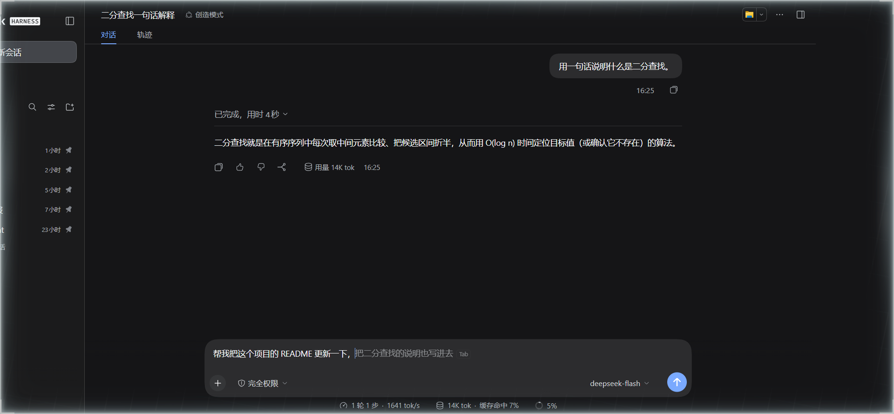
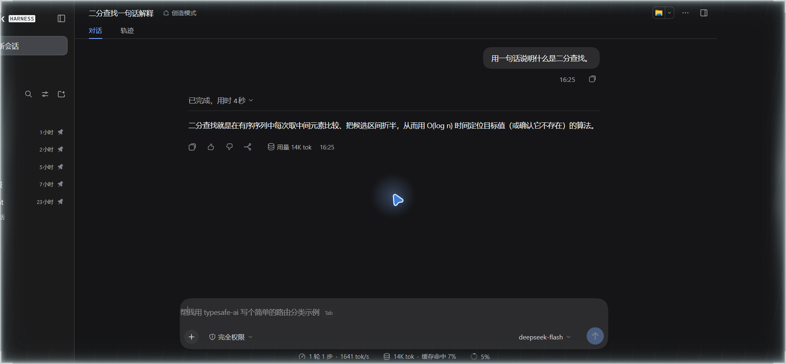
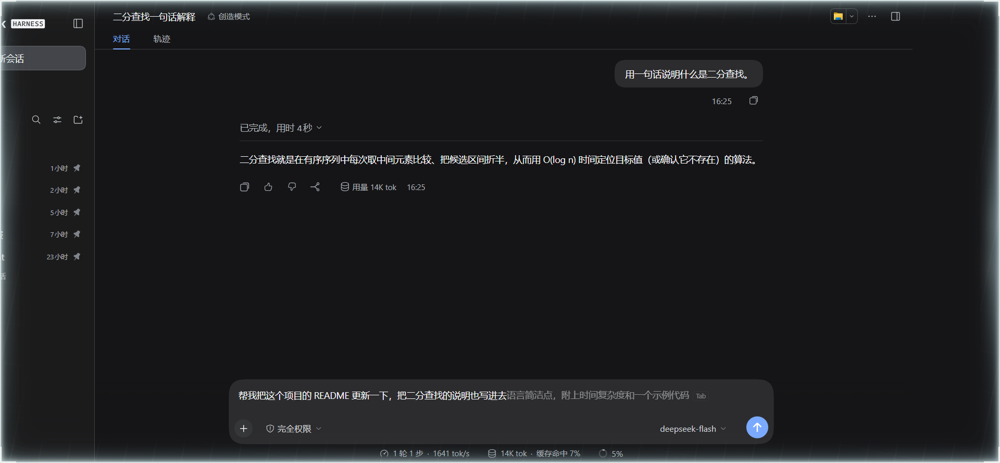

# dsh-tab-complete

在 DeepSeek Harness 的输入框里，用当前对话和你已经打的字，预测你**接下来要输入的内容**：灰色幽灵文本贴在光标后面，按 <kbd>Tab</kbd> 一键填入，按 <kbd>Esc</kbd> 忽略。

这是 Codex Pro「下一步输入预测」的 DeepSeek Harness 版本。区别只有一处：预测走你自己的模型路由，不吃订阅额度。



## 它什么时候会给建议

| 时机 | 行为 |
| --- | --- |
| 你在输入框里打字 | 停手约 0.55 秒后，补全你这句话的剩余部分 |
| 你刚发完一条消息、输入框是空的 | 基于这段对话，预测你的**下一句话**（用户口吻，不是助手口吻） |
| 候选是助手刚说过的话的复述 | 直接丢弃，不显示 |
| 你在用输入法（IME）拼字 | 不预测，避免和候选栏打架 |
| 输入框以 `/` 开头 | 不预测，那是命令面板 |



按 <kbd>Tab</kbd> 之后：幽灵文本变成真正的文字，光标停在末尾，接着就能改。



## 安装

插件是标准的 DSH bundle：宿主半边注册一条 HTTP 路由，客户端半边挂在 `conversation.input.overlay` 插槽上。

在 profile 目录（`~/.dsh/profiles/<profile>/`）里加两处：

```jsonc
// package.json
{
  "dependencies": {
    "dsh-tab-complete": "link:D:/Projects/dsh-tab-complete"  // 或 npm 版本号
  },
  "dsh": {
    "profile": {
      "bundles": ["...", "dsh-tab-complete"]
    }
  }
}
```

然后安装并重启 Harness：

```powershell
cd $env:USERPROFILE\.dsh\profiles\desktop
pnpm install
```

重启后窗口里的输入框就有这个能力；已经在跑的会话不会丢，会话记录是落盘的。

## 配置

宿主侧配置写在 bundle 的 `cordis.patch.yml` 对应条目下，全部可省略：

```yaml
- id: dsh-tab-complete
  config:
    enabled: true
    debounceMs: 550        # 停手多久后请求
    maxTokens: 48          # 生成上限
    maxCompletionChars: 120
    contextMessages: 8     # 送给模型的历史消息条数
    contextChars: 2400
    minDraftChars: 0       # 空输入框也预测，设成 2 就要求先打两个字
    provider: ""           # 留空则用当前会话的默认模型路由
    model: ""
```

运行时可查状态、可临时开关（内存态，重启复位）：

```powershell
curl.exe http://127.0.0.1:3080/dsh-tab-complete/state       # 需要浏览器同款 cookie
curl.exe -X POST http://127.0.0.1:3080/dsh-tab-complete/enabled -d '{\"enabled\":false}'
```

## 成本与隐私

- 每次预测是一次独立的小模型调用（`maxTokens: 48`，一句话），**不写进会话记录**，也不消耗 Harness 的上下文。
- 只接受来自 loopback 的请求；请求体上限 64 KB。
- 同样的「会话 + 草稿」结果缓存 2 分钟；"模型也没想出来"缓存 20 秒，避免空输入框反复花钱。
- 同一会话同时只保留一个在飞请求，新请求会中断旧的。

## 实现要点

- 宿主：`ctx.webServer.register` 三条路由；`llm.stream` 一次性调用；历史取自 `session.deriveMessages()`（拿不到就退回事件日志的 `user/message` / `assistant/message`）。
- 客户端：`conversation.input.overlay` 插槽里的一个 0 高度覆盖层，绝对定位到测量出来的光标位置，字体、行高、字间距照抄编辑器，所以看起来就是「接下来要打的字」。
- 落字走 `inputActions.insertText(text, span)`，带 `draftRev` 的 CAS：请求发出后你要是继续打字，这次补全就作废，不会插到错误的位置；CAS 失败再退回 `setDraft`。
- <kbd>Tab</kbd> 在捕获阶段拦下并 `stopImmediatePropagation()`，编辑器的缩进逻辑看不到它，也不会误触发。

## 已知限制

- 依赖编辑器的 `data-composer-card` / `data-composer-input` 标记，Harness 大改输入框结构时需要跟着调整。
- 幽灵文本的定位按「光标在草稿末尾」优化；多行草稿且光标在中间时，补全仍贴在最后一行末尾。
- 模型偶尔会给出不相关的建议，这时按 <kbd>Esc</kbd> 就好——预测本身是有损的。

## 开发

```powershell
node scripts/build.mjs      # src/ -> lib/（无依赖打包）
node --test test/*.test.mjs # 12 个用例
```

`src/core.js` 是纯函数（提示词、清洗、转录裁剪），`src/host.js` 是宿主半边，`src/client.cjs` 是插槽组件，`src/client-css.cjs` 是样式。`lib/` 是构建产物，随仓库一起提交，安装时不用自己构建。

## License

MIT
